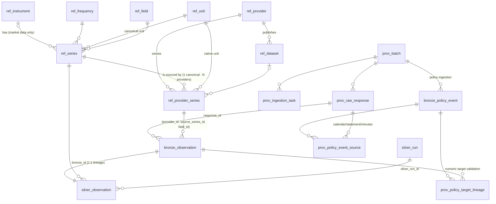

# Schema & relationships

DDL: `src/macrodb/schema.sql` (DuckDB, idempotent). Parquet snapshots: `macrodb export` (see Storage).

## Entity-relationship diagram

## Layers

| Layer | Tables | Mutability |
|---|---|---|
| Reference | `ref_provider`, `ref_frequency`, `ref_unit`, `ref_field`, `ref_instrument`, `ref_series`, `ref_dataset`, `ref_provider_series` | Synced from `config/*.yaml` (idempotent). Key/FK columns of referenced rows are immutable. |
| Provenance | `prov_batch`, `prov_raw_response`, `prov_ingestion_task` | Append (batch row gets `finished_at`/`status` once). |
| Bronze | `bronze_observation`, `bronze_policy_event` (+ Parquet snapshots) | **Append-only.** Corrections create new versions, never overwrite original facts. |
| Silver | `silver_observation`, `silver_run` | Rebuildable: a deterministic function of Bronze + reference + DQ config. |
| Gold | — | Reserved, not implemented. |

## Key relationships and cardinalities

* **canonical series 1 — N provider mappings.** `ref_series.series_id` is provider-independent;
  `ref_provider_series (provider_id, source_series_id, field_id)` maps a provider's identifier to it,
  with `priority` (lower = preferred), `native_unit_id`, and `pit_support`.
* **One provider payload can feed several canonical series** (e.g. Yahoo OHLCV: one JSON -> five series), which
  is why `field_id` is part of the mapping key.
* **instrument 1 — N series** (`SPY.open`, `SPY.close`, …). Macro series have `instrument_id IS NULL`.
* **raw response 1 — N Bronze rows**; the file is content-addressed (`sha256`) under `data/raw/<provider>/YYYY/MM/`.
* **Bronze row 1 — 1 Silver row** (`silver.bronze_id` = `bronze.bronze_id`): nothing is dropped, so lineage
  is total. Rejected/suspect rows stay with `dq_status`/`dq_flags`.

## Bronze columns (source-faithful)

| Column | Meaning |
|---|---|
| `provider_id, source_series_id, field_id` | FK to the mapping; the *source's* identifiers |
| `obs_date_raw` / `observation_date` / `observation_ts` | original date string / parsed period start (NULL if unparseable) / timestamp if the source has one |
| `value_raw` / `value_num` | original text (`"."`, `"3.90"`) / parsed number (NULL if not numeric) |
| `realtime_start`, `realtime_end` | **vintage**: first date this value was current; last date seen current (informational) |
| `published_at` | publication timestamp **when the provider supplies one** |
| `source_attrs` | JSON of source-side attributes (e.g. ECB `OBS_STATUS`) |
| `ingested_at`, `batch_id`, `response_id` | when we stored it, which batch, which archived payload |
| `row_hash` | UNIQUE idempotency key over (provider, series, field, raw date, raw value, realtime_start, published_at) |

Revision rule: same hash → skipped (idempotent). Changed value or new `realtime_start` → new hash →
**appended**; the old row is never touched.

## Time concepts (point-in-time)

FOMC documents use the same `prov_raw_response` / `data/raw/` archive as market providers.
`bronze_policy_event` stores source-backed announcements with separate date, nullable clock,
timezone-aware `known_at`, scheduled status, single/range bounds and timing basis. Its full source
payload preserves evidence and URLs. `prov_policy_event_source` links calendar/statement/minutes
responses; `prov_policy_target_lineage` links the underlying scalar target Bronze facts.
`prov_policy_exclusion` records non-target actions rejected by each ingestion batch.
`MacroDB.policy_events()` selects the latest event version; it does not convert assumed historical
availability into verified publication timing.

The registered scalar series `US.FED_FUNDS.TARGET.SINGLE/LOWER/UPPER` pass through ordinary Bronze/Silver.
FRED effective-date targets are loaded as current-only facts, without fabricated vintage dates.
They are calendar-day settings, not business-day market observations; weekday-based daily coverage
percentages are not appropriate for these series. The single-target series is historical/discontinued.

| Concept | Column | Notes |
|---|---|---|
| Observation date | `observation_date` | Period the number describes (normalised to period start in Silver; `period_end` also stored). |
| Publication timestamp | `published_at` | Only if the provider says so. |
| Vintage | `realtime_start` | ALFRED: date a value first became current. |
| Ingestion timestamp | `ingested_at` | When *we* first saw it. Never a substitute for publication. |
| **Availability** | `availability_ts` + `availability_basis` | Silver's "knowable-from" time: `vintage` → `realtime_start` (day granularity); `publication_ts` → `published_at`; `ingestion_only` → `ingested_at`. `pit_reliable` is TRUE only for the first two. |

Rows from providers without vintages/publication times are **explicitly flagged `pit_reliable = FALSE`**;
`MacroDB.as_of()` warns (`PointInTimeWarning`) or, with `pit="strict"`, excludes them. Such an as-of query can
only say "what had *we* stored by then", not "what was public by then".

## Silver DQ vocabulary

`dq_status`: `ok` | `suspect` | `missing` | `invalid`. `dq_flags` (list):

| Flag | Status | Check |
|---|---|---|
| `BAD_DATE`, `BAD_VALUE`, `NONFINITE` | invalid | schema: unparseable date / non-numeric value / inf-nan |
| `MISSING_VALUE` | missing | provider missing marker (`.`, empty, `NA`, …) |
| `FREQ_MISALIGNED` | suspect | date not at start/end of its period (M/Q/A) |
| `FUTURE_DATE` | suspect | observation date after ingestion date |
| `NONPOSITIVE_PRICE`, `NEGATIVE_VOLUME` | suspect | value sanity (price-like fields must be > 0) |
| `OHLC_INCONSISTENT` | suspect | high < max(open, close, low) or low > min(open, close, high) |
| `OUTLIER` | suspect | robust z-score (MAD) of the first difference (`diff`) or log return (`logret`) above `ref_series.outlier_threshold`; computed on latest versions; off with `outlier_method: none` |
| `DUPLICATE_CONFLICT` | suspect | same period, same availability time, different values |
| `PIT_INFO_MISSING` | — | mapping promises vintage/publication info but the row lacks it |

`duplicate_class`: `unique` | `revision` (≥2 versions with different values) | `duplicate_same_value` |
`conflict`. Unit normalisation: `value × native.to_base_factor / canonical.to_base_factor`
(same `dimension` only; enforced when the catalog loads). Frequency is never resampled: native frequency must
equal the canonical frequency.

## Storage

User-approved estimates are appended to ordinary `bronze_observation` in the original provider/series
mapping, then flow into Silver. They retain the original CPIAUCSL/CPILFESL identifiers. Their
`source_attrs` and archived local JSON explicitly record `is_estimate`, origin, formula, rounding and
the two input Bronze IDs; request provenance uses a local `urn:macrodb:user-approved-estimate:...`,
not a fabricated FRED API response. Original missing versions remain intact.

`MacroDB.get()` uses these flagged estimates by default, only when the latest official value is missing.
Returned estimates have `dq_flags` including `ESTIMATED`, `dq_status="suspect"` and `pit_reliable=False`.
They carry no fabricated publication/vintage timestamp. `include_estimates=False` selects source-only
history before version selection, allowing original frozen inputs to reproduce exactly.
`vintage="first"`, `quality="ok"` and strict PIT queries exclude estimates. All-version queries retain
the official missing versions and the estimate records. Known official values always win, including
after later refreshes. Research snapshot logic applies estimates only after creation and before the
decision close, and propagates estimated-history flags to inputs and states.

* `data/macrodb.duckdb` — all tables.
* `data/raw/` — gzip raw responses (content-addressed, write-once).
* `data/parquet/bronze_batches/<batch_id>.parquet` — immutable per-batch Bronze copies, written at ingest.
* `macrodb export` → `data/parquet/{bronze,silver}/provider_id=…/` and `data/parquet/reference/*.parquet`
  (full snapshots, overwritten on each export).
* Policy-event and lineage snapshots: `data/parquet/policy/*.parquet`.
* Estimates are included in ordinary Bronze/Silver Parquet; audit: `data/reports/approved_estimates.csv`.
